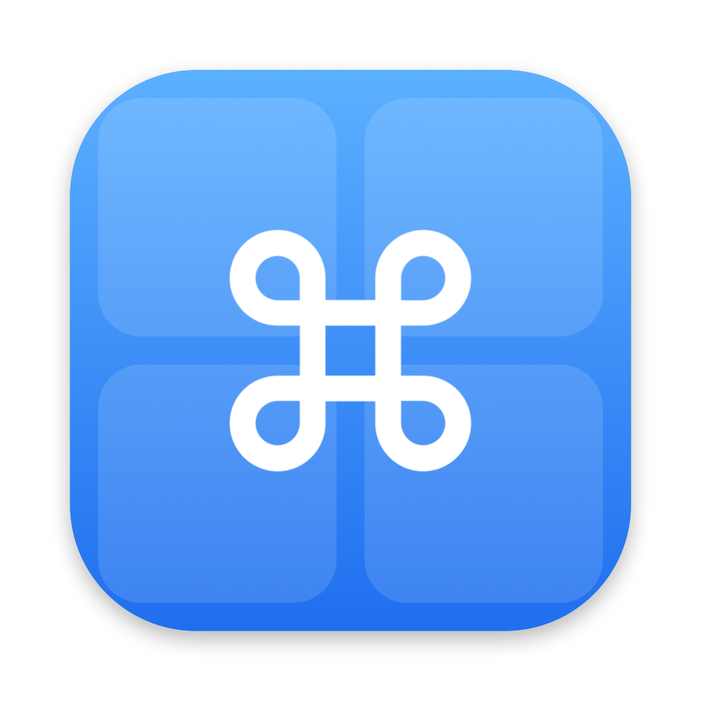

<p align="center">
  
</p>

<h1 align="center">TileDeck</h1>

<p align="center">
  Bộ công cụ trên thanh menu cho macOS: siêu nhẹ, một app thay cho nhiều app.<br>
  <sub>A lightweight all-in-one menu bar toolkit for macOS.</sub>
</p>

---

TileDeck gom vào một icon ⌘ trên thanh menu những việc thường phải cài 6–7 app riêng: chỉnh độ sáng màn ngoài, chuyển cửa sổ kiểu AltTab, chia cửa sổ kiểu Rectangle, lịch sử clipboard kiểu Maccy, sắp xếp icon thanh menu kiểu Ice, điều khiển quạt kiểu Macs Fan Control và âm lượng từng app kiểu SoundFlow.

Viết bằng Swift + AppKit, không dùng thư viện ngoài. Khi rảnh: **0% CPU, khoảng 11 MB RAM**. Mọi thứ chạy theo sự kiện của hệ thống, chỉ đọc định kỳ khi bảng đang mở.

## Tính năng

| Tab | Có gì |
|---|---|
| **Màn hình** | Chống sleep (Caffeinate) có hẹn giờ · độ sáng từng màn, kể cả màn ngoài qua DDC · F1/F2 chỉnh màn đang có con trỏ, kèm OSD gốc của macOS · tắt màn / ngắt mềm màn không cần rút cáp |
| **Pin** | % pin, công suất, độ khỏe, chu kỳ sạc, nhiệt độ, củ sạc · cảnh báo pin nóng / pin yếu khi dùng màn ngoài · Sleep Guard (chặn Dark Wake, tắt Bluetooth khi gập máy) · đóng băng app ngốn CPU · lịch hiệu chuẩn pin |
| **Phím tắt** | ⌘Tab theo từng cửa sổ, có ảnh xem trước, mọi Space · chia cửa sổ ⌃⌥ + mũi tên, chuyển màn ⌃⌥⌘ + ←/→ · clipboard ⌘⇧C (tìm kiếm, ghim, dán nhanh 1–9) · bấm chuột trái + phải để mở Mission Control |
| **Menu bar** | Gom icon thừa sau vạch ⏽, tự ẩn · kéo thả để sắp xếp ngay trong danh sách · tên riêng cho Wi‑Fi, Pin, Đồng hồ… |
| **Quạt** | Tốc độ quạt, nhiệt độ theo nhóm và bảng toàn bộ cảm biến · chế độ Tự động / Cố định / Theo nhiệt độ của cảm biến tự chọn, có làm mượt |
| **Âm thanh** | Chọn thiết bị và âm lượng đầu ra/đầu vào · âm lượng và tắt tiếng riêng cho từng app |

## Yêu cầu

- macOS **14.2** trở lên.
- Mac **Apple Silicon**. Mới kiểm thử trên MacBook Pro M4 Pro chạy macOS 15.8. Trên Mac Intel, các phần DDC, quạt và SMC nhiều khả năng không chạy.

## Cài đặt

Tải file `TileDeck-<phiên bản>.zip` ở mục [Releases](https://github.com/dungng2808/TileDeck/releases), giải nén rồi kéo `TileDeck.app` vào thư mục Ứng dụng.

Lần đầu mở, TileDeck hiện bảng **Quyền truy cập**. Mỗi quyền chỉ cần cho tính năng dùng đến nó, bạn bỏ qua quyền nào cũng được:

| Quyền | Dùng cho |
|---|---|
| Trợ năng (Accessibility) | F1/F2 màn ngoài, ⌘Tab, chia cửa sổ, dán clipboard, cử chỉ chuột, sắp xếp thanh menu |
| Ghi màn hình | Ảnh xem trước cửa sổ trong ⌘Tab |
| Ghi âm thanh hệ thống | Âm lượng từng app |
| Thông báo | Cảnh báo pin, lịch hiệu chuẩn |
| Chạy nền (Mục đăng nhập) | Trình trợ giúp điều khiển quạt |

## Vì sao không có trên Mac App Store

App trên Mac App Store phải chạy trong sandbox và chỉ được dùng API công khai. TileDeck cần những thứ sandbox chặn (điều khiển cửa sổ app khác, ghi SMC qua trình trợ giúp chạy quyền root, đóng băng tiến trình) và một số API riêng của macOS (SkyLight, DisplayServices, IOAVService). Rectangle, AltTab, Ice, Stats và Macs Fan Control cũng phát hành ngoài App Store vì cùng lý do.

## Tự build

```bash
git clone https://github.com/dungng2808/TileDeck.git
cd TileDeck
scripts/build.sh          # tạo build/TileDeck.app
open build/TileDeck.app
```

Cần Xcode 16 trở lên (Swift 6). `build.sh` tự tìm chứng chỉ ký "Apple Development" hoặc "Developer ID" trong Keychain; nếu không có thì ký ad-hoc. Khi đó trình trợ giúp quạt không chạy được, và macOS sẽ hỏi lại quyền Trợ năng sau mỗi lần build.

Chạy bộ kiểm thử:

```bash
swift test
```

Một số bài kiểm thử đọc phần cứng thật (SMC, màn hình, thiết bị âm thanh) và tự bỏ qua trên máy không có phần cứng đó.

Để phát hành bản notarize (cần tài khoản Apple Developer Program và chứng chỉ Developer ID), xem [`scripts/release.sh`](scripts/release.sh).

## Cấu trúc

```
Sources/
  CSMC/              Đọc/ghi SMC (C)
  FanHelperShared/   Giao thức XPC giữa app và trình trợ giúp quạt
  TileDeckHelper/    Trình trợ giúp quạt chạy quyền root (launchd daemon)
  TileDeck/
    App/             Khởi động, icon thanh menu
    Core/            Phím tắt, event tap, Accessibility, SMC, pin, API riêng
    Features/        Display · Battery · Windows · Clipboard · Fans · Sound
    UI/              Các tab và bảng điều khiển (SwiftUI)
Tests/TileDeckTests/ Bộ kiểm thử
```

## Ủng hộ

TileDeck miễn phí và mã nguồn mở. Nếu app có ích với bạn, bạn có thể mời mình một ly cà phê qua VietQR. Quét bằng app ngân hàng bất kỳ, số tiền tuỳ bạn. Trong app, bấm nút ♡ Ủng hộ ở cuối bảng để mở mã này.


## Giấy phép

[MIT](LICENSE). Tên các cảm biến nhiệt lấy theo bảng của [Stats](https://github.com/exelban/stats) (MIT), xem [THIRD_PARTY_NOTICES.md](THIRD_PARTY_NOTICES.md).
